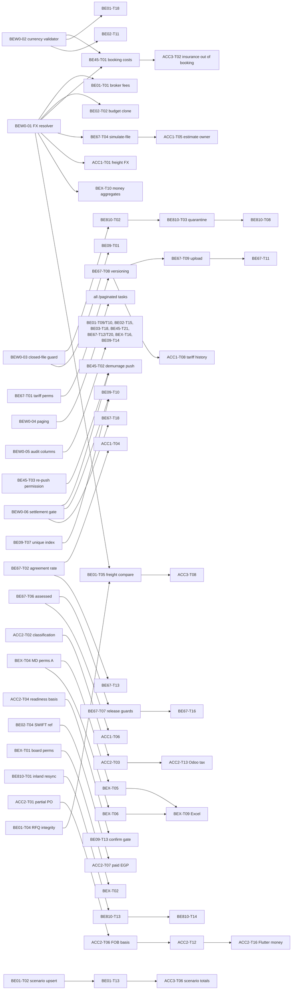

# Backend + accounting review: master plan (lead)

Status: 2026-10-06. Lead consolidation of 11 static reviews (2026-10-05). No code was edited, no test was run, `import main`
was not run, no DB was touched. The single checklist is [`TASKS.md`](TASKS.md). Each task keeps the steps, acceptance
criteria and tests of its source report; this file holds what the reports do not: the merged Wave 0 tasks, waves, order,
dependencies, migrations, API changes and execution rules.

## 1. Scope

Every backend module under `modules/` plus the money math across modules:

| Area | Modules | Report |
|---|---|---|
| Phase 01 planning | `purchase_orders`, `cbm_calculator`, `shipping_scenarios`, `customs_consultation`, `import_requirements`, `freight_quotations` | [be-01](be-01-review.md) |
| Phase 02 financial approval | `financial_approval` | [be-02](be-02-review.md) |
| Phase 03 documentation | `import_documentation`, `docs_customs_approval`, `original_documents_collection`, `smart_document_upload` | [be-03](be-03-review.md) |
| Phases 04-05 freight + cargo | `freight_booking`, `cargo_insurance`, `cargo_shipping`, `shipment_updates`, `demurrage_detention` | [be-04-05](be-04-05-review.md) |
| Phases 06-07 customs | `customs_clearance`, `customs_clearance_quotations`, `customs_tariff` | [be-06-07](be-06-07-review.md) |
| Phases 08 + 10 | `warehouse_receiving`, `inland_transport`, `file_closure` | [be-08-10](be-08-10-review.md) |
| Phase 09 settlement workflow | `financial_settlement`, `recalculation` | [be-09](be-09-review.md) |
| Cross-cutting | `auth`, `audit_logs`, `lifecycle_board`, `import_files`, master data (`currencies`, `incoterms`, `projects`, `suppliers`, `import_companies`, `transport_locations`, `expense_catalog`, `external_service_providers`), `common`, `database`, `main.py` | [be-cross](be-cross-review.md) |
| Accounting: customs | duty / VAT / tariff engine, phase-1 estimate vs actual | [acc-customs](acc-customs-review.md) |
| Accounting: settlement | payments, FX, CLO-01 / CLO-02, Odoo journal | [acc-settlement](acc-settlement-review.md) |
| Accounting: logistics costs | freight, insurance, demurrage, inland, quotes, allocation | [acc-logistics-costs](acc-logistics-costs-review.md) |

Out of scope: Flutter screens (parallel review in [`../frontend-review/`](../frontend-review/README.md)); the SWIFT MT103
parser regexes; PDF / Excel layout code.

## 2. Method

1. Each reviewer read its modules (depth listed in each report header) and filed findings with `file:line`, severity,
   fix, then turned them into tasks with steps, acceptance criteria and tests with numbers.
   Severity: **BLOCKER** = wrong money, data corruption, security or auth bypass. **CRITICAL** = wrong result or 500 on a
   normal path. **MAJOR** = rule violation, real risk. **MINOR** = hygiene.
2. The lead read all 11 reports, then spot-checked 16 of the most severe findings against the code, all money BLOCKERs
   first. For money findings the worked example was recomputed by hand (section 4).
3. Duplicates with one root cause in several modules were merged into one task that the others depend on (section 6).
4. The list paging contract was aligned with the frontend review
   ([`cross-cutting-tables-and-view.md` §3.5](../frontend-review/cross-cutting-tables-and-view.md)); see section 11.

## 3. Coverage

| Report | BLOCKER | CRITICAL | MAJOR | MINOR | Tasks |
|---|---|---|---|---|---|
| [be-01](be-01-review.md) | 2 | 4 | 16 | 11 | 22 |
| [be-02](be-02-review.md) | 2 | 2 | 12 | 10 | 18 |
| [be-03](be-03-review.md) | 3 | 5 | 15 | 6 | 20 |
| [be-04-05](be-04-05-review.md) | 3 | 3 | 18 | 7 | 23 |
| [be-06-07](be-06-07-review.md) | 6 | 7 | 19 | 9 | 21 |
| [be-08-10](be-08-10-review.md) | 2 | 4 | 18 | 12 | 20 |
| [be-09](be-09-review.md) | 4 | 1 | 9 | 8 | 14 |
| [be-cross](be-cross-review.md) | 6 | 5 | 22 | 9 | 17 |
| [acc-customs](acc-customs-review.md) | 1 | 3 | 7 | 4 | 14 |
| [acc-settlement](acc-settlement-review.md) | 1 | 3 | 14 | 5 | 17 |
| [acc-logistics-costs](acc-logistics-costs-review.md) | 3 | 2 | 6 | 8 | 14 |
| **Total** | **33** | **39** | **156** | **89** | **200** |

317 findings, 200 report tasks. After the merges, [`TASKS.md`](TASKS.md) has 200 rows: 6 report tasks folded into
6 new Wave 0 tasks. Rejected findings: **none** (every spot-check confirmed the finding and its numbers).

## 4. Lead verification (spot-checks)

| Finding | Checked at | Worked example recomputed | Verdict |
|---|---|---|---|
| BE01-F01 broker fees summed across currencies | `customs_consultation/repository.py:299-317,456-475`, `service.py:302-305` | EGP 1,000 + USD 100 x 2 (+ EGP 500 not applicable), USD 50: code 1,200, correct 11,000 | CONFIRMED |
| BE01-F03 code generator restarts after `-COPY` | `customs_consultation/repository.py:269-293`, `service.py:462` | `CUS-2026-003-COPY` -> `ValueError` -> `001` -> unique index 500 | CONFIRMED |
| BE02-F02 budget clone freight at invoice rate | `financial_approval/service.py:964-971` | freight EUR 2,000, new invoice rate 52, EUR 55: code 104,000, correct 110,000 | CONFIRMED |
| BE03-F01 PO line written twice | `import_documentation/service.py:1248-1285`; Flutter `po_reconciliation_tab.dart:978-979,1005` | packing row carries `poItemId` and overwrites `quantity` with `qty_pcs` | CONFIRMED |
| BE45-F01 booking charges summed whatever currency | `freight_booking/service.py:66-88`; settlement `financial_settlement/service.py:1401-1405` | THC 4,000 EGP read as 4,000 USD -> 200,000 EGP at 50 | CONFIRMED |
| ACC3-F01 per-container line x all containers | same function; Flutter `freight_booking_form_dialog.dart:494-513` | 2 x 40HC @ 2,000 + 1 x 20GP @ 1,200: code 9,600, correct 5,200 USD | CONFIRMED |
| ACC3-F02 insurance inside booking freight | `freight_booking_form_dialog.dart:549` ("Marine Insurance" line) | premium counted in booking and certificate | CONFIRMED |
| ACC3-F03 estimate uses quote `total_cost` as CIF freight | `financial_settlement/service.py:899-909`; `freight_quotations/repository.py:69` | FOB 5,000,000, quote 3,000+400+600 USD, ins. 125,000: CIF 5,325,000 vs 5,275,000; duty -5,000, VAT -7,700, freight -50,000 = 62,700 EGP | CONFIRMED |
| BE45-F02 demurrage push writes stale totals | `demurrage_detention/service.py:729-790` (no recalculation before `_write_settlement_rows`) | 20 days after discharge pushes the 0 stored at creation | CONFIRMED |
| BE67-F02 fixed-rate agreement uses `reduction_percentage` | `customs_tariff/service.py:221-224,684-686`; parser `nafeza_text_parser.py:229-237`; origin check `:1249-1255` uses the right field | Mercosur 3% stored as 1.00 -> 1%: CIF 100,000 duty 1,000 vs 3,000 | CONFIRMED |
| BEX-F03 / BE67-F04 fabricated FX | `currencies/service.py:170-189`; caller `customs_tariff/service.py:596-601` | USD with no rate row -> 48.50 (cached 5 min, `rate_id=None`) | CONFIRMED |
| ACC1-F01 foreign freight at the invoice rate | `customs_tariff/service.py:476-479` | 20,000 EUR @55, freight 2,000 USD @50: total taxes 326,700 vs 324,060 (+2,640) | CONFIRMED |
| BE09-F04 / BE67-F06 clearance snapshot rewrites settlement | `customs_clearance/service.py:1379-1407` (no lock check, total = sum of `net_payable_egp`) | freight 50,000 + duty 100,000 + broker net 5,000 -> `total_expenses_egp` 5,000 instead of 155,000 | CONFIRMED |
| BE09-F01 recalculation un-approves | `recalculation/service.py:453-469`, `financial_settlement/validators.py:43-84` | Approved -> `Calculated`, file stays `COST_ALLOCATED` -> never re-approvable | CONFIRMED |
| BE810-F01 phantom inland cost | `inland_transport/service.py:88` (create only); `financial_settlement/service.py:1705-1744` | fare 5,000 then PUT 0 -> fallback still charges 5,000 | CONFIRMED |
| ACC2-F01 partial PO costed in full | grep: `POShipmentAllocation` read nowhere outside `purchase_orders`; `financial_settlement/service.py:410-456` | PO 500,000 EGP split 400/600 units: each file costs 500,000 | CONFIRMED |
| BEX-F01 / BE67-F01 / BEX-F04 auth | `lifecycle_board/router.py:29-32`; `customs_tariff/router.py:42`; `init_from_db` only in `auth/router.py:107,168` | n/a | CONFIRMED |

## 5. Top risks for real money and data

1. **Freight booked at the wrong amount** (BE45-F01, ACC3-F01, ACC3-F02): one booking total adds EUR / EGP / CNY charges as
   USD, multiplies each per-size sea-freight line by all containers, and includes marine insurance (also booked by the
   certificate). The settlement converts that total at the USD rate: 4,000 EGP THC becomes 200,000 EGP; 5,200 USD
   becomes 9,600 USD.
2. **Approved landed cost changes behind the accountant** (BE09-F01, F03, F04, BE67-F06): a justified recalculation turns an
   Approved settlement back to Calculated; recalculation replaces actual Form-46 duty / freight / clearance with planning
   estimates; a CL-05 clearance invoice rewrites `total_expenses_egp` of an Approved settlement to the sum of
   `net_payable_egp` (5,000 instead of 155,000).
3. **Fabricated exchange rates** (BEX-F03 = BE67-F04): `_get_rate_to_egp` returns USD 48.50 / EUR 52.80 or 1.0 when no rate
   exists; the customs engine and `/currencies/convert` use it silently (100,000 JPY priced as 100,000 EGP).
4. **Wrong customs duty** (BE67-F02, F03, F09, F10; ACC1-F01, F02): fixed-rate agreements charged 1% instead of 3%, negative
   duty possible, expired agreements applied, Nafeza extra fees cut by schedule tax, foreign freight at the invoice rate,
   exempted lines taxed on their freight share. Under-declared duty is a customs penalty risk; over-declared is cash lost.
5. **Partial shipments costed twice** (ACC2-F01): a PO split over two files puts its full FOB into both landed costs.
6. **Other money**: broker fees summed across currencies into the budget (BE01-F01); phantom inland fare (BE810-F01);
   phase-1 estimate inflated 62,700 EGP by local + inland charges inside CIF (ACC3-F03); demurrage pushed stale (BE45-F02)
   or accruing forever after the empty return (ACC3-F04); EUR tiers converted at the USD rate (ACC3-F05); estimated
   duties typed by the client (ACC1-F05); invented 14 free days (BE45-F04); budget override never cleared (BE02-F01);
   fabricated SWIFT reference (BE02-F04).
7. **Data and security**: any logged-in user can close a file through the lifecycle board (BEX-F01), edit tariffs and
   rates (BE67-F01) or master data (BEX-F02); logout does not survive a restart (BEX-F04); PO lines overwritten by packing
   rows (BE03-F01); scenario edits orphan bookings (BE01-F02); any import-file PUT rewinds progress (BEX-F08); a Closed
   file stays writable (BE810-F02, BE09-F02).

## 6. Merged duplicates (one root cause, one task)

| New / owner task | Merged from | Root cause | Depends on it |
|---|---|---|---|
| **BEW0-01** Shared FX resolver, no fabricated rates | BEX-T07, BE67-T03 (+ `fallback_rates` shared need) | `currencies/service.py:170-189` fallback + no customs-rate helper | BE01-T01, BE01-T05, BE02-T02, BE45-T01, BE67-T04, BEX-T10, ACC1-T01, ACC1-T05, ACC1-T07, ACC2-T17, ACC3-T06, ACC3-T07 |
| **BEW0-02** Currency master validation helper | currency parts of BE01-T18, BE02-T11, BE03-T13, BE45-T01, BE810-T12, BE67-T18, ACC2-T05, ACC2-T11 | free-text currency with invented `"USD"` / `"EGP"` defaults in ~10 modules | the listed tasks (each keeps its own schema change) |
| **BEW0-03** Closed-file guard + code `IMPORT_FILE_CLOSED` | step 1 of BE810-T02 and BE09-T01 | no module checks `ImportFile.status == "Closed"` | BE810-T02, BE09-T01 |
| **BEW0-04** List paging helper + `/paginated` contract | BEX-T13 (+ paging parts of BE01-T15, BE02-T08, BE03-T14, BE45-T15/T16, BE67-T15/T21, BE810-T18, BE09-T12, BEX-T14/T15) | 3 different paging shapes proposed | all paging tasks |
| **BEW0-05** One Alembic revision for audit + soft-delete columns | migration parts of BE01-T09, BE01-T10, BE02-T15, BE03-T18, BE45-T21, BE67-T12, BE67-T20, BEX-T16 (a), BE09-T14 | `created_by` / `updated_by` / `deleted_*` missing on 25+ tables; 9 parallel migrations would fork the Alembic head | the listed tasks (they keep the service wiring) |
| **BEW0-06** Settlement external-write gate | BE67-T05, BE09-T04 | other modules write the settlement without its lock and without its engine | BE45-T02, BE45-T09, BE09-T10, BE67-T18 |
| **BE45-T01** (owner) | ACC3-T01 | both rewrite `calculate_transit_time_and_costs` charge math | ACC3-T02, BE45-T20 |

Related but kept separate (different root cause, ordered by dependency): BE01-T05 -> ACC3-T08 (same benchmark function);
BE67-T06 -> ACC1-T06; BE67-T02 -> ACC1-T04, BE67-T13; BE67-T08 -> ACC1-T08, ACC1-T09; BE67-T10 -> ACC1-T10;
ACC2-T04 -> BE09-T13 (readiness basis must change before the confirm gate); BE01-T02/T13 -> ACC3-T06;
BEX-T11 step 5 also closes BE810-F25 (reopen audit).

### Wave 0 task cards (new tasks, not in any report)

**BEW0-01 Shared FX resolver, no fabricated rates** (BLOCKER, review required)
- Files: `modules/currencies/service.py`, `modules/customs_tariff/service.py`, `modules/common/system_messages.py`,
  `docs/system_message_codes.json`, `tests/unit/test_currency_rates.py`.
- Steps: BEX-T07 steps 1-3 (delete `fallback_rates`; 404 `CURRENCY_NOT_FOUND`, 409 `CURRENCY_RATE_MISSING`; never cache a
  miss) + BE67-T03 steps 1-2 (`_customs_rate(db, currency, on_date)` raising 422 `CT_CUSTOMS_RATE_MISSING`, used at
  `customs_tariff/service.py:596-601,1404-1407`). Callers that already test `rate_id` (`customs_consultation/service.py:876`,
  `financial_settlement/service.py:365`) re-map the new 409 to their own coded error.
- Tests: BEX-T07 numeric cases (USD 50.00 / customs 49.00 -> 5,000.00 / 4,900.00; USD->EUR 94.70; miss not cached) +
  BE67-T03 cases.

**BEW0-02 Currency master validation helper** (MAJOR, yes)
- Files: `modules/common/validators.py`, `tests/unit/test_common_currency_validator.py`.
- Steps: `require_currency_code(db, code, label_ar) -> str`: strip + upper, must be an active row of `currencies`
  (400 Arabic, coded `CURRENCY_CODE_UNKNOWN`); `None` stays `None` (callers decide "required when amount > 0").
  No module change in this task; module tasks call it and remove their `"USD"` / `"EGP"` defaults.
- Tests: `"usd"` -> `"USD"`; `"XYZ"` -> 400; inactive currency -> 400.

**BEW0-03 Closed-file guard** (BLOCKER, yes)
- Files: `modules/common/validators.py`, `modules/common/system_messages.py`, `docs/system_message_codes.json`, Flutter
  catalogs (registration only), `tests/unit/test_common_file_open_guard.py`.
- Steps: `ensure_file_open(imp)` -> 409 `{code: "IMPORT_FILE_CLOSED", message, import_file_code}` when
  `imp.status in ("Closed", "Archived")` (message text of BE810-T02 step 1).
- Tests: Closed and Archived -> 409; In Progress -> no error.

**BEW0-04 List paging helper and contract** (MAJOR, yes)
- Files: new `modules/common/pagination.py`, `modules/import_files/router.py`, `modules/import_files/repository.py`,
  `modules/common/system_messages.py`, `tests/unit/test_pagination_contract.py`.
- Steps: BEX-T13 steps 1-3 with the aligned contract of section 11 (`page_size` 1..200, error `LIST_SORT_FIELD_INVALID`,
  `include_inactive`). Write `docs/standards/list-paging-contract.md` only if FEX-T03 has not (one doc, one owner).
- Tests: BEX-T13 cases with `page_size=201` -> 422 and `sort=hacker` -> 400 `LIST_SORT_FIELD_INVALID`.

**BEW0-05 Audit and soft-delete columns** (MAJOR, review required: migration)
- Files: one `alembic/versions/<rev>_audit_softdelete_columns.py`; the model files (one or two lines each); split in two
  PRs by module group if more than 5 model files (models first, wiring in the module tasks).
- Columns (all nullable, no backfill unless stated): `created_by`, `updated_by` VARCHAR(100) on `clearance_expense_types`,
  `broker_price_lists`, `freight_rfq_requests`, `payment_request_sessions`, `import_budget_approvals`, the 9
  import-documentation tables of BE03-T18, `shipment_bookings` (backfill from `owner`), `customs_tariffs`,
  `preferential_agreements`, `fee_codes`, `customs_clearance_rfqs`, `customs_clearance_quotations`,
  `clearance_price_list_items`, `projects`, `transport_locations`, `expense_catalog`, `currencies`; `deleted_at` DATETIME
  and `deleted_by` VARCHAR(100) on `customs_tariffs` and `financial_settlement_records`. Guard each column with
  `sa.inspect` (skip when present); downgrade drops with `batch_alter_table`.
- Tests: upgrade on a scratch DB, columns present, legacy rows NULL, `shipment_bookings.created_by == owner`.

**BEW0-06 Settlement external-write gate** (BLOCKER, review required)
- Files: `modules/financial_settlement/service.py`, `modules/financial_settlement/validators.py`,
  `modules/customs_clearance/service.py`, `modules/customs_clearance/validators.py`, `tests/unit/test_cl05_clearance_fees_invoices.py`.
- Steps: BE09-T04 step 1 (public `recalculate_settlement_totals(record, actor)`), BE67-T05 steps 1-2 (409
  `CC_SETTLEMENT_LOCKED` on CL-05 create / delete when the settlement is Approved / Closed: CTO Q1 of be-06-07 default),
  BE09-T04 steps 2-3 (snapshot rows then `recalculate_settlement_totals`, no hand-written total).
- Tests: BE67-T05 + BE09-T04 cases (Calculated: freight 50,000 + duty 100,000 + item FOB 500,000, CL-05 5,000 ->
  `total_expenses_egp == 155000.0`, `total_landed_cost_egp == 655000.0`; Approved -> 409 and settlement unchanged).

## 7. Waves

| Wave | Content | Tasks | Gate to start |
|---|---|---|---|
| 0 | Shared foundations (section 6 cards) | 6 | none |
| 1 | BLOCKER + CRITICAL: money first, then security, then data / gates | 62 (30 BLOCKER, 32 CRITICAL) | the Wave 0 tasks it depends on |
| 2 | MAJOR | 109 | Wave 1 task of the same module merged (same files) |
| 3 | MINOR | 23 | none beyond listed dependencies |

Order inside a wave is the row order of [`TASKS.md`](TASKS.md). Tasks on different modules may run in parallel; tasks on
the same files run in the listed order (each report's "Order" note still applies).

Blocked on a CTO answer (do the safe default only when the report gives one; otherwise wait): BEX-T04/T05/T06/T09 (Q1
master-data editors), BE09-T02/T03 (Q1), BE09-T05 (Q3), BE09-T11 (Q4), BE09-T13 (Q2), BE45-T09 (Q4), BE45-T13 (Q5),
BE45-T14 (Q6), BE45-T20 (Q10), BE45-T22 OVERDUE part (Q7), BE03-T20 (Q2 external LLM), ACC1-T02/T03/T05/T06/T07/T14,
ACC2-T06/T07/T09/T13/T14, ACC3-T02 storage part / T07 / T12 / T14, BE01-T22 (Q10), BEX-T16 (Q5 orphan cleanup).

## 8. Dependency graph



The full dependency list per task is the "Depends on" column of [`TASKS.md`](TASKS.md).

## 9. Tasks that need an Alembic migration

All are "review required" and run **one at a time** (each rebased on the single current `alembic heads`; never two
migration PRs open at once).

| Task | Migration | Data step |
|---|---|---|
| BEW0-05 | nullable audit columns on ~25 tables; `deleted_at` / `deleted_by` on `customs_tariffs`, `financial_settlement_records` | backfill `shipment_bookings.created_by/updated_by` from `owner` only |
| BE02-T05 | `server_default` on `revision_number`, `version`, `has_unresolved_variance` | backfill NULL -> 1 / 1 / 0 on `import_budget_approvals`, `payment_request_sessions` |
| BE45-T11 | `shipment_bookings.shipped_on_board_date DATE NULL` | none |
| BE09-T07 | partial unique index `uq_fs_records_active_file` (`WHERE is_active = 1`) | deactivate duplicates first (keep newest Approved, else highest id), print count |
| BEX-T08 | `users.token_version INTEGER NOT NULL server_default 0` | none |
| BEX-T16 | dedupe `shipment_stage_activity` + unique `(import_file_code, step_code)`; `PRAGMA foreign_keys=ON` | orphan report on a DB copy first (CTO Q5) |
| ACC2-T07 | `payment_request_sessions.paid_amount_egp`, `paid_exchange_rate` (Float, nullable) | none |
| Conditional | BEX-T12 unique indexes on `supplier_code` / `project_code` / `task_code` (Q8); BE01-T18 option B `currency_id` FK (Q9); BE01-T07 nullable PO `exchange_rate` (Q2); BE810 Q1 / Q4 / Q7 columns; ACC1 Q9 Float -> Numeric | only after the CTO answer |

Before any migration: read-only counts the reports ask for (BE02 Q4 rate 50.0 budgets, BE09 Q7 duplicates and
`RECALC-ADJ-*` rows, BE01 Q1 non-EGP broker lines, BE67 Q8 `reduction_percentage > 1`) on a copy of the DB, never on
`sorour_logistics.db`.

## 10. API contract changes and Flutter consumers

Every coded error is registered in the same PR in `modules/common/system_messages.py`, `docs/system_message_codes.json`
and `frontend/lib/core/localization/system_messages/system_message_catalog_{ar,en}.dart`
(`tests/unit/test_review_wave_codes.py` fails otherwise).

| Task(s) | Endpoint / field | Change | Flutter consumer |
|---|---|---|---|
| BEW0-01 | `POST /currencies/convert`; `estimate-multi`, `simulate-file` | 409 `CURRENCY_RATE_MISSING`, 404 `CURRENCY_NOT_FOUND`, 422 `CT_CUSTOMS_RATE_MISSING` (no invented rate) | `currencies/providers/currencies_provider.dart:114`, `customs_tariff/providers/customs_tariff_provider.dart:181,198` |
| BEW0-03, BE810-T02, BE09-T01 | every WR / IT / settlement write | 409 `IMPORT_FILE_CLOSED` | `warehouse_receiving_provider.dart`, `inland_transport_provider.dart`, `financial_settlement_provider.dart`, `core/widgets/recalculate_button.dart` |
| BEW0-04 + paging tasks | `GET /<resource>/paginated` | new sibling routes, envelope + `X-Total-Count` | FE PagedListNotifier (FEX-T01/T02), `import_files_provider.dart` |
| BEW0-06 | `POST/DELETE /customs-clearance/invoices` | 409 `CC_SETTLEMENT_LOCKED` | `customs_clearance/widgets/clearance_expenses_dialog.dart` |
| BE45-T01 (+ACC3-T01), ACC3-T02 | `freight-booking` `cost_charges_data[]` | additive `fx_rate_to_usd`, `amount_usd`, `container_type`, `charge_category`; `quantity` float; 422 unknown currency / INSURANCE category; 409 missing rate | `freight_booking/models/freight_booking_model.dart`, `widgets/freight_booking_form_dialog.dart:494-560`, `freight_booking_cost_row.dart` |
| BE45-T02/T03 | demurrage push, PUT tracking, PATCH container, BK-02, EIR | additive `is_provisional`; 403 without `financial_settlement.calculate` on a pushed tracking | `demurrage_detention/providers/demurrage_provider.dart`, `widgets/free_days_agreement_dialog.dart` |
| BE45-T04 | booking `free_demurrage_days` | nullable, `ge=0`; `/confirm` keeps agreed days | `freight_booking_model.dart:278,330`, `freight_booking_confirm_dialog.dart:92` |
| BE45-T05/T06 | insurance create, tracking create | 409 second active certificate / tracking | `cargo_insurance_provider.dart`, `demurrage_provider.dart` |
| ACC3-T04/T05 | tracking / EIR | 422 return without gate-out; `currency` = tariff currency | `demurrage_form_dialogs.dart:88,346`, EIR dialog |
| BE01-T01, ACC1-T05 | `customs-consultations` | `total_broker_fees_egp`, `estimated_duties_egp` server-owned; new `POST /customs-consultation/{id}/estimate-duties` | `customs_consultation_provider.dart`, `customs_consultation_screen.dart:1522` |
| BE01-T02 | `PUT /shipping-scenarios/{id}` | items carry `item_id`; 409 `SCENARIO_ITEMS_BOOKED` | `shipping_scenario_model.dart`, `shipping_scenarios_provider.dart` |
| BE01-T04/T05 | `freight-quotations` | `quotation_id`; `status` / `is_awarded` ignored; EGP comparison fields | `freight_quotation_model.dart`, `freight_quotations_comparison_screen.dart`, `rfq_benchmark_dialog.dart` |
| BE01-T06 | `GET /import-requirements/prefill/{id}` | `shipment_value` nullable, `PREFILL_MIXED_CURRENCY` | `import_requirement_model.dart`, `prefill_messages_banner.dart` |
| BE01-T07/T11 | `POST /purchase-orders` | `exchange_rate` required; 409 `PO_NOT_EDITABLE`, `PO_HAS_ALLOCATIONS` | `purchase_order_model.dart:536,586`, `po_form_dialog.dart` |
| BE02-T04 | `POST /payment-requests/{id}/pay` | 400 `FA_SWIFT_REF_REQUIRED` | `financial_approval_screen.dart:2504-2545`, `financial_approval_provider.dart:172-186` |
| BE02-T06 | override / approve budget | 403 `FA_BUDGET_SOD_DENIED`, 409 `FA_BUDGET_LOCKED`, 400 `FA_BUDGET_STATUS_INVALID` | `financial_approval_screen.dart` (budget dialogs) |
| BE02-T09/T10/T11/T12/T13 | prefill, payment / reconcile payloads | nullable prefill text; currency required; `FA_CURRENCY_UNKNOWN`, `FA_PAYMENT_RATE_REQUIRED`, `FA_SWIFT_VALUE_DATE_INVALID` | `financial_approval_model.dart:120-160`, `financial_approval_provider.dart:191-210,265-290`, `swift_extraction_review_widget.dart` |
| BE03-T01 | `/po-reconciliation` | packing rows update packing only; duplicate `po_item_id` 400; `total_final_amount_by_currency` | `po_reconciliation_tab.dart` (remove `plList.addAll(invList)`) |
| BE03-T05/T06/T07/T08 | recon sessions, ACID, draft B/L, DCA session | gate fields server-owned; `DOC_ACID_CONFLICT`; `unapproved_documents` | `import_documentation_provider.dart:73-182,442-496,909-968`, `docs_customs_approval_provider.dart:306-330` |
| BE67-T01 | `/customs-tariff/*` | 403 without `customs_tariff.view/.edit`; `simulate-file` needs `customs_clearance.update` | `customs_tariff_provider.dart`, `customs_tariff_screen.dart` |
| BE67-T06/T07 | clearance create / PUT / CL-0x | claim fields ignored; 409 `CC_DUTY_NOT_ASSESSED`, `CC_ALREADY_RELEASED`, `CC_ALREADY_PAID` | `customs_clearance_provider.dart`, `customs_duty_payment_dialog.dart`, step dialogs |
| BE67-T08/T09, ACC1-T08 | tariff PUT, upload, with-agreements | new `tariff_id` on rate change; CSV only / 5 MB; 422 back-dated save | `customs_tariff_provider.dart:121,215`, `tariff_form_dialog.dart` |
| ACC1-T01/T02/T04 | `estimate-multi`, `estimate` | `freight_rate_source`, `cif_total_egp`, `dutiable_cif_total_egp`, `cif_base_egp`; 422 exempted > value | `duty_calculator_dialog.dart:31,96,1314,1335-1343`, `hs_code_search_screen.dart:65` |
| BE810-T05/T06 | GRN PUT, dossier | `WR_FIELD_NOT_EDITABLE`, `WR_STATUS_CHANGE_NOT_ALLOWED`; `fob_by_currency`, nullable FOB fields | `warehouse_receiving_screen.dart`, `comprehensive_dossier_model.dart`, export dialog |
| BE09-T02/T03/T05/T06 | recalculation apply, approve | stays Approved; FOB item only; 409 `SETTLEMENT_MANUAL_ROWS_NOT_AGGREGATED`, `INVOICES_NOT_SETTLED`, `SETTLEMENT_NO_ITEMS` | `financial_settlement_provider.dart`, `actual_landed_cost_dialog.dart`, `recalculate_button.dart` |
| ACC2-T04/T06/T12 | CLO-01, CLO-02 | readiness = paid / net payable; `fob_basis`; nullable variance + `NO_ESTIMATE`; 409 `SETTLEMENT_ACTUAL_FOB_MISSING` | `invoices_aggregation_model.dart`, `final_settlement_invoices_dialog.dart`, `actual_landed_cost_model.dart` |
| ACC2-T16 | (no API change) | Flutter stops its own variance / EGP formulas | `landed_cost_comparison_screen.dart`, `landed_cost_comparison_export_service.dart`, `financial_export_service.dart` |
| BEX-T01/T02 | `/lifecycle-board/*` | 403 by permission; `LC_*` codes; `assigned_user` ignored | `lifecycle_board_provider.dart`, `step_config_provider.dart`, `ai_agent_tool_executor.dart` |
| BEX-T04/T05/T06/T09 | master data + Excel imports | 403 by `master_data.view/.edit`; all-or-nothing import; 413 / 415 | currencies / incoterms / projects / suppliers / companies / partners providers, `master_data_toolbar.dart`, `universal_entity_extractor_dialog.dart` |
| BEX-T08 | auth | token version; refresh revokes old token; change-password returns `access_token` | `core/network/api_client.dart`, `auth/providers/auth_provider.dart` |
| BEX-T10/T11 | projects, import files | nullable USD totals + `missing_rate_currencies`; `estimated_cost_by_currency`; `status` not editable by PUT; exact lookup | `project_model.dart`, `import_file_model.dart`, `import_files_provider.dart` |

MAJOR / MINOR contract changes not listed here are in section 4 ("Frontend impact") of each report; they keep that
wording. Rule for every money field: Flutter displays the backend value and never recomputes it.

## 11. List paging contract (aligned with the frontend review)

The frontend review's contract ([`cross-cutting-tables-and-view.md` §3.5](../frontend-review/cross-cutting-tables-and-view.md),
backend need B1) is the one contract. It supersedes the header-only `skip` / `limit` designs of BE01-T15, BE02-T08,
BE03-T14, BE45-T15/T16, BE67-T15/T21, BE810-T18, BE09-T12 and the 500 / 422 details of BEX-T13 §4.1.

```
GET /api/v1/<entity>/paginated?page=1&page_size=50&sort=-created_at,code&q=text&include_inactive=false&<filters>
200 {"items":[<EntityListItem>...], "total":12345, "page":1, "page_size":50, "total_pages":247}
Header: X-Total-Count: 12345   (additive; Flutter reads "total" from the body)
page >= 1; page_size 1..200 (422 otherwise); unknown sort field -> 400 {"code":"LIST_SORT_FIELD_INVALID","field","allowed"}
Primary key always appended as the last sort key; a page past the end returns items [] with the real total.
```

- Helper: `modules/common/pagination.py` (`PageParams`, `Page[T]`, `apply_sort`, `like_term`, `paginate`), task BEW0-04.
- Existing list routes stay unchanged (pickers and old screens use them). Paging tasks add the `/paginated` sibling with
  a light `<Entity>ListItem` schema (no nested line items) and the same `require_permission("<module>.view")`.
- Priority (FE B1 order merged with BEX §4.1): import files (bounds), customs tariff, audit logs, purchase orders,
  payment requests / budgets, smart tasks, transport locations, suppliers / companies / partners, notifications, then the
  phase registries (import documentation, bookings, cargo shipping, shipment updates, trackings, GRN, inland transport,
  clearance, settlements).
- Follow-ups owned by the frontend plan: `/lookup?q&limit&ids` (B3) and filtered server export (B5).

## 12. Execution rules

1. **One task per branch and per PR.** Branch from `main`, name `fix/<task-id>-<slug>` (English). Conventional Commits.
   No AI attribution anywhere. Open the PR only when asked, to the branch named by the owner.
2. **Track 1 only** (`docs/DEV_WORKFLOW.md`): no version bump, no `version.json` edit, no packaging, no
   `package_production.py`.
3. **Never run against `sorour_logistics.db`.** Every test, probe and `TestClient` run uses a scratch `DATABASE_PATH`
   (the pytest fixtures do this). Never edit `.env` or `*.db`.
4. Before testing any write path on a copy of real data, run `python scripts/daily_backup.py --test`.
5. Run pytest for the touched files with `--junitxml=<scratch>/junit.xml` and read the result from the XML and the exit
   code (after `import main` the final "N passed" line is suppressed). Python 3.12: import every `typing` name used in a
   signature.
6. **Money tasks** (column "review required" with a money reason: FX, duty, VAT, landed cost, freight, demurrage,
   insurance, payments, settlement, Odoo) are reviewed by the `customs-rules-reviewer` agent before merge; the worked
   example of the task must be a test.
7. Migrations: one open migration PR at a time, `down_revision` = the single current head, upgrade tested on a scratch DB
   (section 9).
8. New coded errors: registered in the same PR (section 10 header) or listed in `docs/plans/review-shared-needs.md`.
9. A task that changes a contract updates the Flutter consumer in a paired FE task (frontend plan) or keeps the old field
   accepted and ignored for one release (as each task states).
10. After merge: tick the row in `TASKS.md` and append one line to `history/YYYY-MM-DD.md` (append-only).

### Tasks NOT safe for Antigravity ("needs senior review")

A task is marked **review required** in `TASKS.md` when it touches any of:
- an Alembic migration or a DB constraint / pragma;
- money math: FX, duty / VAT / fees, CIF, landed cost, allocation, freight / demurrage / insurance amounts, payments,
  budgets, settlement, recalculation, Odoo journal, or a Flutter screen that shows those numbers;
- auth: permissions, tokens, segregation of duties, four-eyes, approval or certification gates, data sent to external
  services.

These tasks are done by a senior developer (or Claude Code with the `customs-rules-reviewer` / `security-reviewer`
agents) and reviewed before merge. Antigravity may take the rows marked **yes** (validation, hygiene, legacy-tolerant
schemas, paging, Arabic messages, workflow guards without money).

## 13. CTO decisions that unblock the most work

| # | Question | Blocks | Safe default in the reports |
|---|---|---|---|
| 1 | Which roles get `master_data.edit` (be-cross Q1) | BEX-T04/T05/T06/T09 | GENERAL_MANAGER + LOGISTICS_OPERATOR; rates ADMIN + FINANCE_OFFICER |
| 2 | FOB basis of the actual landed cost (acc-settlement Q1) | ACC2-T06, T12, ACC2-T16 | invoice basis, items scaled to it |
| 3 | Settlement recalculation scope (be-09 Q1) | BE09-T02, T03 | FOB only; Approved stays Approved |
| 4 | Deemed insurance / freight for estimates (acc-customs Q2) | ACC1-T03, BE01-T17 | values in `system_parameters` |
| 5 | Seller-paid freight / insurance by Incoterm (acc-logistics Q1, acc-settlement Q9) | ACC3-T14 | freight excluded for C/D terms, insurance for CIF / CIP |
| 6 | VAT and WHT in landed cost (acc-customs Q4, acc-settlement Q6) | ACC2-T13 | flag off (today's behaviour) |
| 7 | Contract choice for list paging (frontend Q2) | all paging tasks | envelope, section 11 (lead decision, confirm) |
| 8 | Enable `PRAGMA foreign_keys` after an orphan report (be-cross Q5) | BEX-T16 | report first, then cleanup migration |
