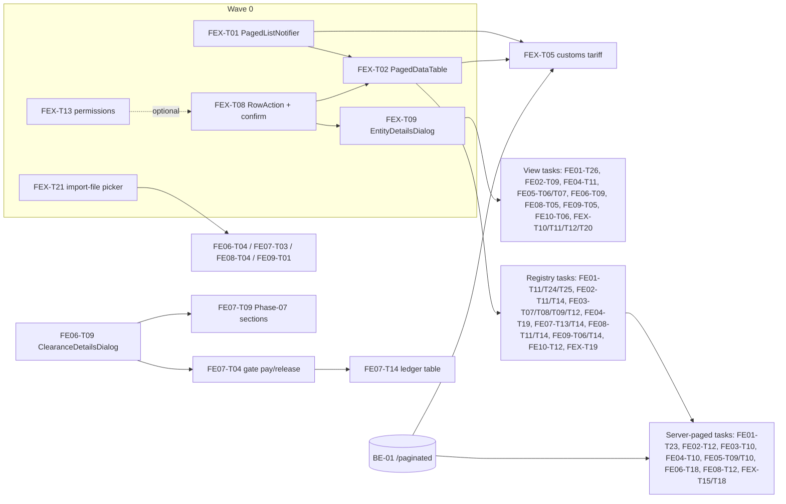

# Frontend review, phases 1-10: master plan

Date: 2026-10-05 · Owner: lead reviewer · Track 1 (daily work: no version bump, no packaging)
Execution checklist: [TASKS.md](TASKS.md) (one row per task; the only place where status is tracked).

> ملخص: 11 مراجِع راجعوا واجهة Flutter (المراحل 1-10 + الجداول المشتركة). الخطة دي بتجمّع كل النتائج في 4 موجات تنفيذ.
> الأولوية: إيقاف أي قيمة مخترعة أو فلوس غلط (Wave 1)، بعد ما نبني الجدول المشترك وزر "عرض" الموحّد (Wave 0).

## 1. Scope and method

- **Scope:** Flutter Windows desktop app (`frontend/lib/**`), screens of business phases 1-10 (BP-001..BP-040), plus the shared
  table, row-action, error and permission widgets. Backend contracts were read only to check the frontend against them.
- **Method:** static review only (no `flutter test`, no `pytest`, no `import main`, no code edited). Each reviewer read the
  listed files (full or partial, see the coverage table in each report), checked JSON keys against `modules/*/schemas.py`,
  re-checked the previous quality-wave items, and wrote findings (`F<phase>-NN`) and self-contained tasks (`FE<phase>-TNN`).
  The cross-cutting reviewer owns the standards for large tables and the View action (`FX-NN`, `FEX-TNN`).
- **Lead pass:** I read all 11 reports in full, spot-checked the most severe findings against the code, merged the duplicates
  across phases, and set the waves, dependencies and the backend list below.

### Coverage

| Phase | Report | BLOCKER | CRITICAL | MAJOR | MINOR | Tasks |
|---|---|---|---|---|---|---|
| 01 Import planning (PO, CBM, scenarios, consultation, requirements, freight RFQ) | [phase-01](phase-01-frontend-review.md) | 3 | 6 | 21 | 6 | 28 |
| 02 Financial approval (payments, budgets, SWIFT) | [phase-02](phase-02-frontend-review.md) | 1 | 6 | 19 | 13 | 18 |
| 03 Import documentation (ACID, Form 4, Form 46, reviews, original docs) | [phase-03](phase-03-frontend-review.md) | 2 | 2 | 13 | 7 | 15 |
| 04 Freight booking + cargo insurance | [phase-04](phase-04-frontend-review.md) | 2 | 7 | 23 | 6 | 21 |
| 05 Cargo shipping, shipment updates, demurrage | [phase-05](phase-05-frontend-review.md) | 2 | 5 | 21 | 8 | 14 |
| 06 Customs preparation (CS-01..03, Form 46, broker RFQs) | [phase-06](phase-06-frontend-review.md) | 6 | 5 | 18 | 7 | 19 |
| 07 Customs clearance (CL-01..05, under-bond, ledger) | [phase-07](phase-07-frontend-review.md) | 5 | 5 | 14 | 7 | 15 |
| 08 Warehouse receiving + inland transport | [phase-08](phase-08-frontend-review.md) | 1 | 3 | 23 | 8 | 17 |
| 09 Financial settlement (CLO-01/02, PL-08, Odoo) | [phase-09](phase-09-frontend-review.md) | 1 | 3 | 15 | 6 | 15 |
| 10 File closure (CLO-03/04) | [phase-10](phase-10-frontend-review.md) | 0 | 2 | 13 | 10 | 14 |
| Cross-cutting: large tables + View action | [cross-cutting](cross-cutting-tables-and-view.md) | 0 | 2 | 11 | 6 | 20 |
| **Total as reported** | | **23** | **46** | **191** | **84** | **196** |
| **After lead merge** | | **21** | **44** | ~190 | 84 | **194 executable + 3 merged** (1 task added: FEX-T21) |

Merged duplicates: F03-01 = F06-01 and F03-02 = F06-02 (Form 46 stub save and fake registry); F03-04 and F06-09 are two cases
of FX-01 (silent 100-row cap); F03-13 = F06-25 (Form 46 recomputes the tariff per keystroke).

### Lead spot-check (most severe findings, opened at the cited file:line)

| Finding | Checked at | Result |
|---|---|---|
| F01-01/02 client duty engine, `?? 50.0`, HS `8479.89.90`, `broker_id ?? 1` | `customs_consultation_screen.dart:72, 462, 752, 832, 1516, 1522` | confirmed |
| F01-03 PO rate `?? 1.0`, `orElse: sortedRates.first` | `po_form_dialog.dart:324-327, 968, 3386` | confirmed |
| F02-01 SWIFT ref/date/amount/currency invented | `swift_reconciliation_screen.dart:417-427` | confirmed (smart path; the batch path does not invent) |
| F02-02 "Approve & Certify" calls save only | `financial_approval_screen.dart:4864-4875` | confirmed |
| F03-01 / F06-01 Form 46 save = `Future.delayed(600ms)` | `customs_declaration46_screen.dart:2083-2101` | confirmed |
| F03-02 / F06-02/03 `46-ALX-<code>`, `46-EG-2026-`, today's date, fixed status | same file `:134, 281, 1128, 1243-1244` | confirmed |
| F04-01 `Per Container` × total containers | `freight_booking_form_dialog.dart:498, 508` + `modules/freight_booking/service.py:73-79` | confirmed |
| F05-01 `importFileId ?? 1` into settlement | `demurrage_detention_screen.dart:936` + `service.py:752` | confirmed |
| F05-02 container rebuild drops history/notes/SLA | `cargo_shipping_screen.dart:1404-1426` | confirmed |
| F06-04/05/06 random DEL/46/MTS/DO numbers, D/O fee `12500` | 3 CS dialogs (`:74, 99, 115, 144, 69, 75, 98`) | confirmed |
| F06-07 / F09-01 header stage buttons use `files.first` | `customs_clearance_screen.dart:426-441`, `financial_settlement_screen.dart:376-401` | confirmed |
| F06-08 edit POSTs, backend 400 on second record | `clearance_screen_dialogs.dart:164` + `service.py:361-366` | confirmed |
| F07-01 samples/protocols in screen-state lists | `customs_clearance_screen.dart:62-65` | confirmed |
| F07-03/04/05 `REL-`/`GP-`/`SADAD-` from DB id, bank `NBE`, `SMP-` | 3 CL dialogs | confirmed |
| F08-01 report invents `IMP-<id>`, `PO-MAIN-`, `1 × 40ft HQ`, samples 0 | `warehouse_received_report_export_service.dart:56-66` | confirmed |
| F10-01 status from checklist, not `status` | `file_closure_model.dart:107` + `modules/file_closure/validators.py:152-175` | confirmed |
| F01-05 / F01-06 / F10-02 toolbar calls missing `/export-excel` routes | `master_data_toolbar.dart:122, 255, 266` vs routers | confirmed |
| FX-01 default `limit=100` on RFQs / original docs | `customs_clearance_quotations/router.py:42`, `original_documents_collection/router.py:109` | confirmed |

**Rejected findings: none.** Every sampled finding matched the code, so no phase report was edited.

### Lead decisions (override the report text where they differ)

| # | Decision | Why |
|---|---|---|
| D1 | **Form 46 saves through `POST /customs-clearance/register-declaration-46`** (FE06-T01/T02). FE03-T01/T02 are merged into them; the `/import-documentation/customs-declarations` route and phase-03 backend item B1 are dropped. | That path writes the clearance record and `import_files.form46_no`, which the hub, CL stages and the closure gate already read. The other table is isolated. |
| D2 | **One table standard:** `PagedDataTable<T>` + `PagedListNotifier<T>` (FEX-T01/T02). Every phase task that says `EnterpriseDataTable`, `SettlementLazyTable`, a hand-made pinned header (FE04-T19, FE10-T12) or `FE01-T22` uses `PagedDataTable` instead (client source until the backend pages). `EnterpriseDataTable` stays only for Smart tasks until FEX-T18; FEX-T07 fixes it meanwhile. | `EnterpriseDataTable` is not virtualized, its header is not sticky, and it needs the whole list in memory (FX-04). |
| D3 | **One backend paging contract:** `GET /<entity>/paginated?page&page_size&sort&q&filters → {items,total,page,page_size,total_pages}`. Phase-01's `limit/offset + X-Total-Count` and phase-04's `paged=true {total,items}` are replaced. | Same envelope as the existing `/import-files/paginated`. |
| D4 | **One View standard:** `RowAction<T>` list + `EntityDetailsDialog` loaded by id (FEX-T08/T09). Phase View tasks (FE01-T26, FE02-T09, FE03-T05/T06/T12, FE04-T11, FE05-T06/T07/T12, FE06-T09, FE08-T05, FE09-T05, FE10-T06) build their body on it. | Root cause is shared (section 3). |
| D5 | **Shared import-file picker (new FEX-T21)** used by FE06-T04, FE07-T03, FE08-T04, FE09-T01. | Four phases have the same `files.first` bug; one widget, one test. |
| D6 | Silent truncation: FE06-T08 owns RFQs (fetch all pages), FE03-T04 owns original docs (real paging). FEX-T04 covers only CargoX envelopes, CargoX standard-invoice sessions, experience guide and audit logs. | Avoid two fixes on one provider. |
| D7 | Settlement icons (View = Odoo, Edit = recalculate) are owned by FE09-T02/T05; FEX-T12 keeps Projects and Currencies. Clearance price items are owned by FE06-T12; FEX-T11 keeps Smart tasks. | One owner per file. |
| D8 | FE07-T07 is raised to `CRITICAL*` (Wave 1) because it fixes F07-09 (ledger "Total paid" sums assessed duty). | Wrong money on screen. |

## 2. Answer to the CTO: large tables

**What is wrong today.** Almost no list pages on the server. Only `/import-files/paginated` and cargo insurance (`skip/limit` +
`total`) do, with two different contracts. Most registries download the whole table (POs with every line item, settlements
with all invoice/item JSON) and build every row at once: a `DataTable` inside nested `SingleChildScrollView`s, or a
`shrinkWrap` list. The header scrolls away, nothing sorts, search often runs on every keystroke, and some lists are cut at
100/200 rows with no warning (RFQs, CargoX, original docs, audit logs). Pickers load all import files (91 files) or all POs
(25 files) just to fill a dropdown.

**Chosen standard (one widget, one notifier, one contract):**

1. `PagedListNotifier<T>` with `ListQuery` (page, pageSize 25/50/100 with no "All", sort, `q`, filters, includeInactive).
   It keeps the query across refreshes (CORE_RULES auto-refresh), debounces search 350 ms, cancels stale requests and keeps
   the old rows while the next page loads. Two sources: `ServerPagedSource` (the `/paginated` route) and `ClientPagedSource`
   (slices an already-loaded list), so a screen migrates once and flips to server mode in one line when its endpoint lands.
2. `PagedDataTable<T>`: virtualized `ListView.builder` rows with a fixed row height, a sticky header outside the vertical
   scroll, fixed column widths, pinned actions + code columns at the start edge (right side in Arabic), server sort, column
   picker, a "1-50 of N" footer (`CompactTablePaginationFooter`), shimmer/error/empty states, keyboard (Enter = View), a card
   list below 768 px, and export of the **full filtered set** (backend export route or a page loop, named
   `[Stage] - [File code].ext` via `FileSaveHelper`).
3. Backend: `GET /<entity>/paginated` with a shared helper (`modules/common/pagination.py`), `page_size ≤ 200`, sort whitelist
   + PK tiebreak, light `<Entity>ListItem` rows (no nested line items), `/lookup?q&limit&ids` for pickers, filtered export
   routes. Old list routes stay unchanged.
4. Pickers: `SearchableDropdownField.remote` backed by `/lookup` (FEX-T14).

**Rollout:** Wave 0 builds FEX-T01/T02 (client mode works without any backend change). Wave 1 stops the dangerous cases:
silent caps (FEX-T04, FE03-T04, FE06-T08) and the frozen tariff screen (FEX-T05). Wave 2 migrates screens in this order:
import-files query state → audit logs → purchase orders → payment requests/budgets → smart tasks → CargoX/RFQs/original docs
→ transport locations/partners/projects → phase registries (CBM, scenarios, consultations, ACID, bank, reviews, bookings,
cargo, clearance, ledger, GRN, settlements, closures) → pickers to remote lookup. Each screen first ships in client mode and
switches to server mode when its BE-01 endpoint is merged.

## 3. Answer to the CTO: why there is no View / Show action

**Root cause (same in every phase):**

1. **No GET-by-id on the frontend.** The backend exposes `GET /<entity>/{id}` for almost every entity, but no provider calls it
   for a main entity. So a "View" can only render the stale list row, and building a real details view was never cheaper than
   reusing the editor.
2. **The editor was reused as the viewer.** ACID, Bank Form 4, original docs, couriers, cargo shipping, GRN, incoterms, cost
   items and transport locations open the editable form from "View" or row tap. Some meanings drifted: Projects → audit
   history, Currencies → rate history, Settlements → Odoo journal (and its Edit pencil recalculates money).
3. **The shared row widget hides the gap.** `RowActionsPill` always draws an eye icon; without `onView` it is grey with the
   normal tooltip, so it looks broken. Its default Print shows a fake SnackBar.
4. **No per-record route.** Navigation is an `IndexedStack` of integer indices (`go_router` is a dependency but unused), so a
   record has no address; notifications, audit logs and the AI assistant cannot open one.
5. **No UI permissions.** The client knows only the role; `/auth/me/permissions` is never called, so a view-only user cannot be
   served and Edit/Delete fail with 403 after the click.
6. **Some lists have no list at all:** freight RFQs, inland bookings, SWIFT batches, shortage/discrepancy protocols (session-only).

**Chosen standard:** row actions come from one `List<RowAction<T>>` in fixed order View → Edit → Clone → Print → History →
Delete (+ `⋮` custom). A missing action is hidden; a not-allowed one is disabled with a reason; Delete always confirms and shows
the API result. The same list drives buttons, right-click menu, card menu and Enter/double-click. **View = `EntityDetailsDialog`**
(side sheet ≥ 1200 px, dialog otherwise) that loads `GET /<entity>/{id}` through a per-feature
`FutureProvider.autoDispose.family`, shows business codes (never DB ids), money with its currency, `—` for empty values, audit
fields, and footer Edit / Print / History. `EntityRef` + `EntityDetailsRegistry` let any screen open any record. Permissions come
from `currentPermissionsProvider` (`<module>.view` for View, `.manage` for the rest). Read-only form mode is allowed only for
tiny master data.

## 4. Execution waves

| Wave | Content | Tasks | Starts when |
|---|---|---|---|
| 0 | Shared foundations: FEX-T01 paged notifier, FEX-T13 permissions, FEX-T08 row actions + confirm, FEX-T02 `PagedDataTable`, FEX-T09 `EntityDetailsDialog`, FEX-T21 import-file picker, FEX-T03 paging contract doc | 7 | now |
| 1 | BLOCKER + CRITICAL per phase (invented values, wrong money, wrong shipment, data loss, broken normal paths, silent caps) | 57 | now, in parallel with Wave 0; only FE06-T04, FE07-T03, FE08-T04, FE09-T01 wait for FEX-T21, and FEX-T05 waits for FEX-T01/T02 |
| 2 | MAJOR: View dialogs, registries on `PagedDataTable`, server paging (when BE-01 lands), status labels, exports, form contracts | 118 | after the Wave 0 task named in *Depends on* |
| 3 | MINOR: hygiene, dead code, l10n leftovers, raw error sweep | 12 | any time after its dependency |

Same-file rule: tasks that touch the same file run in their dependency order (for example FE06-T01 → FE06-T02 → FE03-T13;
FE06-T09 → FE07-T04 → FE07-T07/T09/T10 → FE07-T14; FE01-T01 → FE01-T20). Never run two open PRs on one file.

### Dependency graph (main edges)

Backend-blocked tasks (cannot finish until the BE item is merged): FE01-T23, FE01-T25, FE02-T12, FE03-T10, FE04-T10, FE04-T13,
FE05-T09, FE05-T10, FE05-T11 (step 4), FE06-T18 (steps 3-4), FE07-T13, FE08-T07 (edit part), FE08-T12, FE09-T07, FEX-T05
(full total), FEX-T15, FEX-T18. All of them have a frontend-only part or an interim path; the *Backend needed* column says which.

### FEX-T21: Shared import-file picker dialog

- **Severity:** MAJOR (Wave 0) · **Type:** feature · **Depends on:** none · **Backend needed:** no (switch to `SearchableDropdownField.remote` after FEX-T14).
- **Files to change:** new `frontend/lib/core/widgets/import_file_picker_dialog.dart`, the 3 l10n files, new `frontend/test/import_file_picker_dialog_test.dart`.
- **Steps:**
  1. `Future<ImportFileModel?> showImportFilePickerDialog(BuildContext context, WidgetRef ref, {required String title, bool Function(ImportFileModel f)? where, int? excludeId})`.
  2. Body: one `SearchableDropdownField<int>` over `importFilesProvider` items filtered by `where` (default: active files) and `excludeId`; label `primaryNameWithCode — supplierName`; required validator. Buttons `AppButton` Cancel / Continue; Continue disabled until a file is chosen. Empty list → info text, Continue hidden.
  3. Returns the picked `ImportFileModel`, or `null` on cancel. No other side effects.
- **Used by:** FE06-T04 (customs hub CS/CL header buttons), FE07-T03 (add sample), FE08-T04 (book inland, `where`: not ARRIVED), FE09-T01 (CLO-01/CLO-02 header buttons). Those tasks must not create their own picker.
- **Acceptance criteria:** [ ] Cancel returns null and opens nothing. [ ] `where` and `excludeId` filter the items. [ ] Arabic and English labels; RTL correct.
- **Tests:** pump with 3 fake files (one closed): default shows 2 items; Continue disabled until a pick; returns the picked file.

## 5. Common themes (fix inside the phase tasks, same rule everywhere)

| Theme | Rule | Where |
|---|---|---|
| Invented values (refs, FX 1.0/50.0, fees, defaults, `files.first`, `?? 1`) | Field starts empty + required validator; never pick a record the user did not choose. | All Wave 1 BLOCKERs |
| DB id shown as a code (`IMP-<id>`, `#<id>`) | Show the real `import_file_code`, else `—`. BE-05 removes the need to load all files. | FE01-T07, FE02-T18, FE04-T08/T17, FE06-T10, FE08-T01/T06, FE09-T07, FE10-T07 |
| Mixed currencies summed | Group per currency or block; never print `$` over a mixed sum. | FE01-T07, FE02-T03/T07, FE04-T01/T14/T15, FE09-T03/T04 |
| Exports | `FileSaveHelper.exportAndSaveFile`, name `[Stage Name] - [Import File Code].ext`, no `Printing.layoutPdf` as "save", no CSV saved as `.xlsx`, UTF-8 BOM for CSV. | FE01-T16/T19/T20, FE02-T16, FE04-T18, FE06-T15, FE07-T11, FE08-T16, FE10-T14, FEX-T07 |
| Raw errors | `ApiErrorText.of(l, e)` / `ApiError.message(e)` in a red SnackBar or error view with Retry. | phase tasks + FEX-T16 |
| Filters lost on refresh | Notifier keeps the last query; `refresh()` reuses it (built into FEX-T01). | FE01-T08/T13, FE02-T11, FE04-T05/T14, FE05-T11, FE10-T10, FEX-T06 |
| Raw English statuses in Arabic UI | One status → l10n label + severity map per domain (`DomainEnums` where it exists). | FE02-T10, FE03-T03, FE04-T02, FE05-T08, FE06-T10, FE07-T07, FE08-T06 |

## 6. Consolidated backend dependencies

All items below change the API or the schema, so they **need backend-developer, not Antigravity** (Antigravity never edits
`modules/**`). Frontend tasks that list them in *Backend needed* wait for the merge or use the interim path.

| id | Need | Source items | Frontend tasks |
|---|---|---|---|
| BE-01 | `modules/common/pagination.py` (`Page[T]`, `paginate()`), then `GET /<entity>/paginated` (D3 envelope, `page ≥ 1`, `page_size 1..200`, sort whitelist + PK tiebreak, `q`, filters, optional summary/counts block). Priority: customs tariff, audit logs, purchase orders, payment requests + budgets, smart tasks, customs clearance, clearance RFQs, freight booking (+ summary), cargo shipping (+ summary; search on file code, company, container, seal), demurrage trackings/policies (+ summary; remove the silent 100 cap), shipment updates (+ category counts), warehouse receiving (+ `summary.by_status`) and `/warehouse-receiving/lines`, financial settlement (no JSON blobs; search on file code/company), file closure (+ counts), phase-03 registries (ACID, banking docs, draft B/L, COO, inspection, invoice-B/L, PO-rec, original docs total, couriers), CBM, scenarios, consultations, requirements, freight RFQs, transport locations, CargoX, inland bookings. Add `GET /coo/{id}` and `/inspection/{id}`. Bound `import_files/router.py:97-98`. | ph01 §6.1, ph02 B1, ph03 B2/B3/B5, ph04 B04-1, ph05 B1-B3, ph06 1, ph07 B2, ph08 B4-B6, ph09 B2, ph10 1, FX B1 | FE01-T23/T24/T25, FE02-T12, FE03-T04/T10, FE04-T10, FE05-T09/T10/T11, FE06-T18, FE07-T14, FE08-T12/T14, FE09-T06 (phase B), FE10-T12, FEX-T05/T15/T18/T19 |
| BE-02 | `<Entity>ListItem` summary schemas (no nested items) for paged POs, budgets, settlements | ph01 §6.1, FX B2 | FE01-T23, FE02-T12 |
| BE-03 | `/lookup?q&limit&ids` for import files, POs, suppliers, companies, partners, HS codes | ph01 §6.1, FX B3 | FEX-T14, FE01-T23 |
| BE-04 | Filtered export routes (`/<entity>/export-excel?<same filters>`) for full-set export | FX B5, ph09 B2 | export steps of paged tasks |
| BE-05 | Add `import_file_code` (+ `company_name`, `supplier_name` where listed) to the responses of freight booking, customs clearance, warehouse receiving, financial settlement, file closure | ph04 B04-4, ph06 2, ph08 B2, ph09 B1, ph10 2 | FE04-T08, FE06-T10, FE08-T01/T06, FE09-T07, FE10-T07 |
| BE-06 | Audit logs: search + filters (entity type, user, date) and `require_permission("audit_logs.view")` | FX B4 | FEX-T15 |
| BE-07 | `PurchaseOrderCreate.exchange_rate` default `1.0` → required except base currency | ph01 §6.3 | FE01-T03 |
| BE-08 | Freight booking cost engine: stop overwriting per-type quantity of `Per Container` charges; convert to USD or keep totals per currency | ph04 B04-2 | FE04-T01 |
| BE-09 | `ShipmentBookingUpdate` accepts `shipping_line_id`, `freight_forwarder_id`, `pol_location_id`, `pod_location_id`; `/confirm` accepts `container_release_order_no`; duplicate-booking error with `detail.code` | ph04 B04-3/4/5 | FE04-T07, FE04-T13 |
| BE-10 | Customs clearance state guards: 409 on pay after release / re-pay of a fully paid record / second release; optional `is_assessed`, `is_duty_fully_paid` on the response | ph07 B1, B4 | FE07-T04 |
| BE-11 | New soft-deletable entity + CRUD for cargo shortage / damage / discrepancy protocols (Alembic migration, audit fields, claim status code) | ph07 B3 | FE07-T13 |
| BE-12 | Demurrage: push-to-settlement rejects a tracking without import file; check `DemurrageSimulationRequest` literal defaults (250 EGP / 5 days) | ph05 B4, B5 | FE05-T01 |
| BE-13 | Remove invented backend defaults: customs office "Alexandria Port Customs", channel "Red Channel", free days 14 (ph06); warehouse "Main Warehouse - Cairo" (ph08) | ph06 5, ph08 note | after FE06-T03/T13, FE08-T07 |
| BE-14 | Warehouse: `GrnItemSchema.po_number`; `WarehouseReceivingUpdate` + `seal_number`, `driver_phone`, `arrival_datetime`; PUT with new lines recomputes discrepancy/status | ph08 B1, B3, note | FE08-T01, FE08-T07, FE08-T12 |
| BE-15 | File closure: declare/fill `blocking_messages` / `warning_messages` on precheck (FC-13); reopen marks the closure record + audit; optional certificate PDF | ph10 3, 4, 5 | FE10-T04/T08 (FE ready) |
| BE-16 | Financial settlement: `message_code` + params on confirm/approve; CLO-02 line `currency`, `fob_unit_fc`, `unit_of_measure`; `source_note` or drop; approve requires CLO-01 (CTO) | ph09 B3-B6 | FE09-T03, FE09-T08, FE09-T15 |
| BE-17 | Financial approval: `import_file_id` param on payment-requests list; SWIFT review-batch list; `approved_by/at` on payment requests (migration) | ph02 B2-B4 | FE02-T06 (optional), backlog |
| BE-18 | Small contract checks: `CloneBrokerPriceListRequest.copy_items`; consultation `broker_id` nullable in tax-review mode; import-requirements status/risk enum codes; freight RFQ `chargeable_weight_kg` computed by backend; optional PO `discrepancy_justification` field | ph01 §6.4-6.7, FE01-T17 | FE01-T02, FE01-T10, FE01-T17, FE01-T27 |
| BE-19 | Cargo insurance: cancel endpoint, `include_inactive` + restore, `/certificates/summary` per currency | ph04 B04-6 | FE04-T14 (KPIs), FE04-T17 |
| BE-20 | Customs clearance: awarding a clearance RFQ writes `import_file.broker_id` when empty; optional `has_declaration` filter; per-step notes (CTO) | ph06 3, 4; ph07 B5 | FE06-T16 |
| BE-21 | Phase-03: unique active record per `import_file_id` with 409 (ACID, COO, inspection, PO-rec) | ph03 B4 | FE03-T11, FE03-T10 |
| BE-22 | Only if the CTO picks option B: `GET /warehouse-receiving/goods-in-transit` | ph08 Q1 | FE08-T15 |

Dropped by lead decision D1: phase-03 B1 (`GET /import-documentation/customs-declarations`). Still open from earlier plans:
CL-18 (`estimated_duty_total` never populated, so the ledger variance is always 0).

## 7. Rules for whoever executes

1. **One task per branch and per PR.** Branch `fe/<task-id-lowercase>-<short-slug>` from the target branch the owner names.
   Conventional Commits in English (`fix(customs-clearance): …`, `feat(core): …`). No AI attribution anywhere.
2. **Track 1 only** (`docs/DEV_WORKFLOW.md`): no version bump, no `version.json` edit, no packaging, no `package_production.py`.
   Never edit `.env`, `*.db`, or anything under `modules/**` (backend items go to backend-developer, section 6).
3. **Tests:** write the tests the task lists; from `frontend/` run `flutter test <new and touched test files>` and
   `flutter analyze <touched files>`; both clean before the PR. Check the acceptance criteria in Arabic (RTL) and English.
4. **UI rules (CORE_RULES + `ui-screen-standards` skill):** colours only from `AppTheme` (`*Of(context)` for dark mode); every
   user text through `context.l10n` with keys added to all three files (`app_localizations.dart`, `_ar.dart`, `_en.dart`);
   reference data through `SearchableDropdownField` (never `DropdownButtonFormField` or free text for master data); buttons
   `AppButton`; `EdgeInsetsDirectional` / `AlignmentDirectional`; every save/export through
   `FileSaveHelper.exportAndSaveFile` named `[Stage Name] - [Import File Code].ext`; API errors with `ApiErrorText`;
   `ref.invalidate` / `refresh()` after every mutation; no invented defaults, no DB ids shown, money always with its currency.
5. **Do not edit files outside the task.** If a file not listed is needed, stop and explain in the PR. Use the shared widgets
   from Wave 0 instead of building local copies (decisions D2, D4, D5).
6. **Status:** set the task's Status cell in [TASKS.md](TASKS.md) to `review` in the same PR; the reviewer sets `done` after
   merge, or `blocked (<reason>)`. Append one line to `history/YYYY-MM-DD.md` (append-only).
7. **When the report and this README differ, this README wins** (section 1, lead decisions).

## 8. Open questions for the CTO (consolidated; safe default in brackets)

1. Grid engine: may FEX-T02 add the first-party `two_dimensional_scrollables` package (`TableView` with pinned rows/columns)?
   [No new dependency; two synced `ListView`s.]
2. Paging defaults: page size 50 (25/50/100, no "All"), newest first; metric cards show totals of the full filtered set
   (needs a summary block per BE-01 endpoint) or "this page"? [50, newest first, full-set summary where BE-01 provides it, else labelled "this page".]
3. Records as workspace tabs / go_router routes, or side sheet only? [Side sheet now.]
4. Full client-side export cap before requiring a backend export route. [10,000 rows.]
5. Viewer roles: hide or disable actions the user lacks permission for? [Hide; disabled only for state reasons.]
6. Freight booking currencies: one currency per booking, or multi-currency with conversion? [One currency; FE blocks mixed.]
7. Goods-in-transit tab (phase 08 Q1): hide now or build the backend source? [Hide.]
8. Manual "New settlement" form (phase 09 Q1): keep for corrections? Must CLO-01 precede CLO-02 approve? [Keep; FE warns.]
9. Shortage/discrepancy protocols until BE-11: visible read-only with a notice, or hidden? [Visible with notice, no fake save.]
10. Customs offices and warehouses: constant code lists now, master tables later? [Constant list now; master tables next wave.]
11. Closure certificate: keep `.txt` or PDF with QR? [`.txt` now, PDF later via BE-15.]
